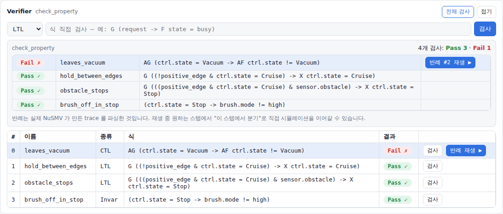
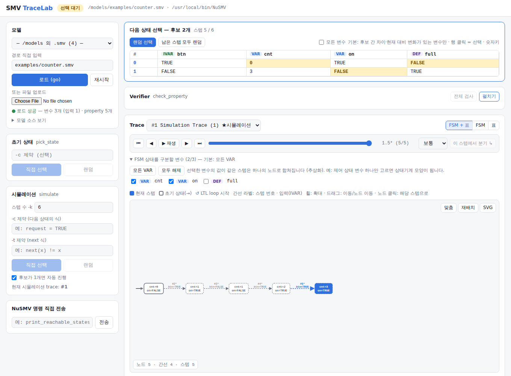
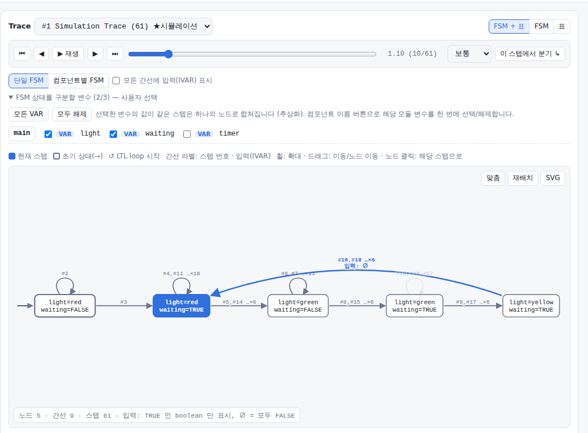
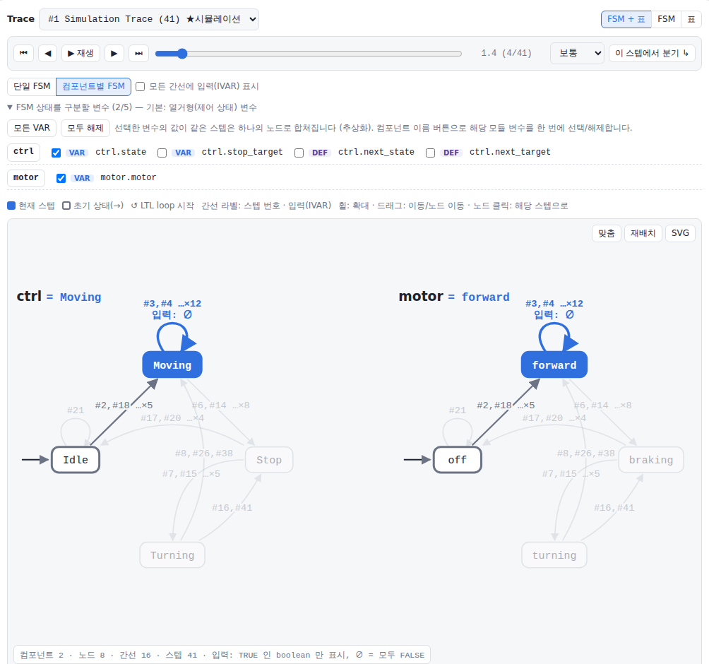
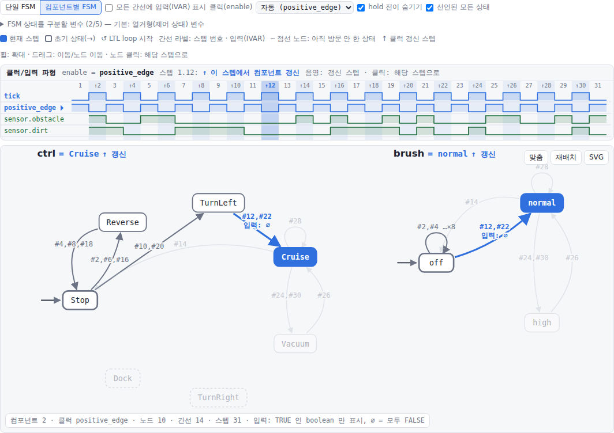

# SMV TraceLab

**NuSMV를 브라우저에서 시뮬레이션하고, trace를 FSM으로 보고, property 반례를 재생하는 도구**

[](https://github.com/sontouf/smv-tracelab/actions/workflows/ci.yml)


SMV TraceLab은 실제 `NuSMV -int` 프로세스를 띄워 놓고 동작합니다. NuSMV의 `simulate -i`가 *"Choose a state from the above"* 하고 입력을 기다리면, 후보 상태를 표로 보여 주고 클릭한 번호를 NuSMV에 그대로 넘깁니다.
결과 trace(`show_traces -v`)는 **표**와 **FSM 그래프**로 보여 주고, `check_property` 결과로 나온 **반례 trace도 같은 화면에서 한 스텝씩 재생**할 수 있습니다.



## 빠른 시작

Python 3.9 이상이 있으면 **설치 없이 바로** 실행할 수 있습니다. NuSMV가 없으면 첫 실행 때 FBK 공식 바이너리(2.7.1)를 자동으로 내려받습니다.

```bash
# uv (권장) — https://docs.astral.sh/uv/
uvx --from git+https://github.com/sontouf/smv-tracelab smv-tracelab

# 또는 pipx
pipx run --spec git+https://github.com/sontouf/smv-tracelab smv-tracelab
```

실행한 디렉터리 아래의 `.smv` 파일이 목록에 나타나고, 브라우저가 자동으로 열립니다 (http://127.0.0.1:8780).

### 설치해서 쓰기

```bash
pip install git+https://github.com/sontouf/smv-tracelab
smv-tracelab                         # 현재 디렉터리의 .smv 목록
smv-tracelab path/to/model.smv       # 바로 로드
smv-tracelab --root ~/models --port 9000 --nusmv /opt/NuSMV/bin/NuSMV
```

### Docker (NuSMV 포함, 아무것도 설치하지 않을 때)

```bash
docker run --rm -p 8780:8780 -v "$PWD:/models" ghcr.io/sontouf/smv-tracelab
```

현재 디렉터리가 `/models`로 마운트됩니다. 마운트하지 않으면 내장 예제(`examples/`)가 보입니다. 이미지는 `linux/amd64`입니다 (Apple Silicon에서는 에뮬레이션으로 동작하며, pip/uvx 방식은 네이티브로 동작합니다).

## 기능

### 1. 대화형 시뮬레이션 (`pick_state -i`, `simulate -i -k N`)
- 후보 상태를 표로 보여 줍니다. 후보끼리 값이 다르거나 현재 상태에서 바뀌는 변수만 기본으로 표시합니다. 행을 클릭하면 그 번호가 NuSMV에 입력됩니다.
- `-k N`으로 N 스텝을 요청하면 N번 선택하게 됩니다. 아직 확정되지 않은 스텝은 trace/FSM에 점선으로 바로 나타납니다.
- IVAR(입력 변수)가 있는 모델은 후보마다 입력값이 함께 표시됩니다.
- 후보가 1개뿐일 때 NuSMV는 Return 입력을 기다립니다 → 자동으로 진행합니다.
- 후보가 너무 많으면 NuSMV가 제약식을 요구합니다 → 화면에 입력창이 뜹니다.
- `-c` / `-t` 제약, 랜덤 시뮬레이션(`-r`), "남은 스텝 모두 랜덤"을 지원합니다.
- **분기**: 아무 스텝에서나 `goto_state`를 실행하면, 그 지점까지 복사한 새 trace에서 시뮬레이션을 이어갑니다.



### 2. Trace → FSM 시각화
- trace에서 방문한 상태를 노드로, 전이를 간선(스텝 번호와 입력값 라벨)으로 그립니다. 같은 상태를 다시 방문하면 사이클로 나타납니다.
- **추상화**: FSM 상태를 구분할 변수를 고를 수 있습니다. 예를 들어 제어 상태 변수 하나만 고르면 수십 스텝짜리 trace가 몇 개 노드의 상태기계로 요약됩니다.
- 재생(▶), 스텝 이동(← →), 슬라이더로 표와 FSM을 함께 움직일 수 있습니다. 노드를 클릭하면 해당 스텝으로 이동합니다.
- 확대/이동/노드 드래그를 지원하고, SVG와 CSV로 내보낼 수 있습니다.



#### 여러 컴포넌트(모듈 인스턴스)로 된 모델
`sensor : Sensor; controller : Controller(...); motor : Motor(controller.next_state)`처럼 여러 모듈로 나뉜 모델은 **컴포넌트별 FSM**으로 자동 전환됩니다.
- 컴포넌트마다 별도의 FSM을 그리고, 같은 재생 커서에 맞춰 함께 움직입니다. 예를 들어 controller가 `Moving → Stop → Turning`으로 가는 순간 motor는 `forward → braking → turning`으로 갑니다.
- 기본 추상화는 컴포넌트별 제어 상태 변수입니다(`state`/`mode` 이름의 열거형 → 다른 열거형 → 그 컴포넌트의 VAR 전체 순). 타이머 같은 숫자 변수는 기본에서 빠지며, 체크박스로 추가할 수 있습니다. 예를 들어 `stop_target`을 켜면 Stop 노드가 목적지별로 나뉩니다.
- 하위 모듈의 IVAR(예: `sensor.front`)은 간선 라벨에 `front·left`처럼 줄여서 표시합니다(TRUE인 boolean만, `∅` = 모두 FALSE). 기본으로는 현재 전이에만 표시합니다.
- 후보 선택 표와 trace 표도 컴포넌트별로 묶여서 표시됩니다.
- 열거형 변수 하나로 구분하는 오토마타는 **선언된 모든 상태**를 노드로 그립니다. 아직 방문하지 않은 상태는 점선으로 보입니다.
- 컴포넌트가 3개면 한 줄에 나란히 놓여 모든 오토마타를 한 화면에서 함께 봅니다.



#### 클럭(positive edge)으로 동기화된 모델
`tick`이 매 스텝 바뀌고 `positive_edge := !tick`일 때만 컴포넌트가 갱신되는 모델(`next(x) := enable ? ... : x`)을 위한 보기입니다.
- 이름이 `positive_edge`/`edge`/`clk`/`clock`/`tick`/`enable`인 boolean 신호를 클럭으로 자동 인식합니다. 툴바의 **클럭(enable)** 에서 직접 고를 수도 있습니다.
- FSM 위에 **클럭/입력 파형**을 그립니다. `tick`, `positive_edge`와 센서 같은 IVAR가 디지털 파형으로 나오고, 재생 커서가 함께 움직입니다. 클럭 갱신이 일어난 스텝은 음영과 `↑`로 표시됩니다.
- 각 컴포넌트 제목에 현재 스텝이 `↑ 갱신`인지 `hold`인지 표시합니다.
- **hold 전이 숨기기**(기본 켬): 클럭이 FALSE라서 상태를 유지하기만 하는 self-loop는 그리지 않습니다. 끄면 점선으로 보입니다.
- 클럭 신호는 파형으로 보여 주므로 FSM 기본 변수에서는 빠집니다. 예제: `examples/clocked_components.smv`



### 3. Verifier
- 모델의 `CTLSPEC` / `LTLSPEC` / `INVARSPEC` 목록과 검사 상태를 보여 줍니다. 개별 검사와 전체 검사를 지원합니다.
- 식을 직접 입력해 검사할 수 있습니다 (`check_ltlspec -p`, `check_ctlspec -p`, `check_invar -p`).
- 검사 결과는 property마다 **Pass ✓ / Fail ✗** 로 모두 나열되고, Fail에는 그 property의 반례 trace 버튼이 붙습니다.
- **반례 재생**: false인 property의 반례 trace를 FSM, 클럭 파형, 표에서 한 스텝씩 재생합니다. LTL 반례의 loop 시작점(↺)도 표시합니다. 반례는 NuSMV가 `check_ctlspec`/`check_ltlspec`/`check_invar`로 만든 trace를 `show_traces -v`로 받아 파싱한 것입니다.
- 반례의 원하는 스텝에서 분기해 **직접 시뮬레이션을 이어갈 수 있습니다** (예: "여기서 다른 입력을 주면 어떻게 될까?").

### 4. 콘솔
NuSMV와 주고받은 원본 입출력을 모두 볼 수 있고, 임의의 NuSMV 명령을 직접 보낼 수도 있습니다.

## NuSMV 바이너리

찾는 순서: `--nusmv` → `$NUSMV` → `PATH`의 `NuSMV`/`nusmv` → 자동 다운로드 캐시.

| 플랫폼 | 자동 다운로드 | 비고 |
|---|---|---|
| Linux x86_64 | `NuSMV-2.7.1-linux64` | `libxml2`, `libedit`가 필요합니다 (`sudo apt install libxml2 libedit2`). Debian/Ubuntu의 `libedit.so.2`는 자동으로 연결됩니다. |
| macOS (Apple Silicon/Intel) | [이 저장소 Release의 universal 빌드](https://github.com/sontouf/smv-tracelab/releases/tag/nusmv-2.7.1) | FBK 공식 macOS 바이너리는 x86_64 전용이고 MacPorts 라이브러리에 링크되어 있어 일반 Mac에서 실행되지 않습니다. 그래서 공식 소스를 [CI에서 직접 빌드](.github/workflows/nusmv-macos.yml)한 자체 완결형 바이너리를 씁니다 (GMP/libxml2 제외, 시스템 libedit. 소스 변경은 빠진 `#include` 한 줄뿐). |
| Windows x64 | `NuSMV-2.7.1-win64` | `pywinpty`와 `pyte`가 함께 설치됩니다. |
| 그 외 (Linux ARM 등) | 없음 | 소스에서 빌드한 뒤 `--nusmv`로 지정하세요. |

미리 받아 두려면 `smv-tracelab --install-nusmv`를 실행하세요. `--no-download`를 주면 자동 다운로드를 끕니다.
NuSMV는 FBK-irst가 LGPL 2.1로 배포하는 별도 소프트웨어이며, 이 저장소에는 포함되어 있지 않습니다.

## 동작 원리

```
브라우저 ──HTTP/JSON──▶ smv-tracelab (Python 표준 라이브러리 HTTP 서버)
                              │  pty (Linux/macOS) / ConPTY + pyte (Windows)
                              ▼
                         NuSMV -int model.smv
```

- NuSMV를 파이프에 연결하면 출력이 버퍼에 쌓여서, 선택지 목록이 *답을 보낸 뒤에야* 나옵니다. 그래서 **가상 터미널(pty)** 에 연결합니다.
- 출력 끝에 나오는 프롬프트(`NuSMV >`, `Choose a state…`, `Press Return…`, `further constraints: >`)를 보고 NuSMV가 무엇을 기다리는지 판단합니다.
- 후보 목록은 항상 `-a` 옵션으로 받습니다. `-a`가 없으면 NuSMV가 이전 후보와 달라진 변수만 출력합니다.
- Windows의 ConPTY는 프로그램 출력을 그대로 넘기지 않고 가상 화면을 다시 그립니다(커서 이동, 공백 채우기, 입력 에코). 그래서 [`pyte`](https://github.com/selectel/pyte) 터미널 에뮬레이터로 화면을 재현해 텍스트를 복원합니다.
- Linux/macOS에서는 외부 의존성이 없습니다 (Windows에서만 `pywinpty`, `pyte` 사용). UI는 단일 HTML 파일이며 CDN을 쓰지 않아 오프라인에서도 동작합니다.

## 주의

- 서버는 NuSMV 세션 하나를 공유합니다. 여러 탭에서 동시에 조작하지 마세요.
- 기본으로 `127.0.0.1`에만 열립니다. 웹 UI에서 임의의 NuSMV 명령과 파일 경로를 다룰 수 있으므로 `--host 0.0.0.0`으로 외부에 공개하지 마세요.

## 개발

```bash
git clone https://github.com/sontouf/smv-tracelab && cd smv-tracelab
pip install -e . pytest
smv-tracelab --install-nusmv
pytest -v
```

CI는 Linux/macOS/Windows에서 NuSMV 공식 바이너리를 내려받아 실제 프로세스로 테스트하고, `main`에 push할 때마다 Docker 이미지를 `ghcr.io/sontouf/smv-tracelab`에 게시합니다.

---

### English

**SMV TraceLab** drives a real `NuSMV -int` process from your browser: it answers `simulate -i` / `pick_state -i` choice prompts with the state you click, renders traces as a table and as an (optionally abstracted) FSM graph with step-by-step playback (one FSM per component, all declared states shown, plus a clock/input waveform for `positive_edge`-gated models), and checks CTL/LTL/INVAR properties, letting you replay counterexamples and branch from any step (`goto_state`) to keep simulating.

```bash
uvx --from git+https://github.com/sontouf/smv-tracelab smv-tracelab        # NuSMV is downloaded on first run
docker run --rm -p 8780:8780 -v "$PWD:/models" ghcr.io/sontouf/smv-tracelab
```

MIT licensed. NuSMV is © FBK-irst, LGPL 2.1, and is not bundled.
